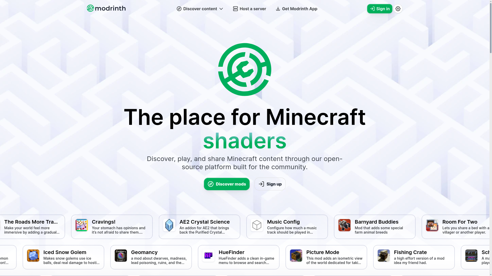

# DESIGN.md: Modrinth-inspired EconomyCraft landing page

## Source
- URL: https://modrinth.com/
- Capture date: 2026-10-24
- Evidence: Firecrawl branding, images, and markdown scrape in `.firecrawl/modrinth-branding.json`; full-page screenshot downloaded to `.firecrawl/modrinth-reference.png`; live page structure and content.

## Reference Screenshot

Use this as a reference for hierarchy, spacing, density, and product discovery. Do not reuse Modrinth logos, imagery, or copy.

## Design Summary
Modrinth pairs a clean, light canvas and vivid green actions with large plain-language headings, compact navigation, and image-led discovery. EconomyCraft should borrow the clarity and product-first hierarchy while using its own in-game screenshot, economy vocabulary, and server-owner focus.

## Design Tokens

### Colors
- Action green: `#00AF5C` (observed primary)
- Ink: `#2C2E31` (observed primary text)
- Deep slate: `#111827` (observed secondary)
- Canvas: `#EBEBEB` (observed background)
- Soft lavender-gray: `#B1B5CA` (observed accent/link)
- EconomyCraft dark green: `#174D34` (inferred product frame/accent; do not recolor reference screenshot)

### Typography
- Modrinth uses Inter for both headings and body (observed).
- Use an Inter-first system sans stack for EconomyCraft; avoid the previous serif display treatment.
- Hero: 56–76px responsive, weight 750–850, tight line-height; body 16–18px with comfortable line-height.

### Spacing And Layout
- Modrinth’s measured spacing uses a 4px base; its common rounded surfaces are about 12–16px.
- Use a centered content width around 1240px, generous hero whitespace, and a 12-column content grid.
- Use one primary green action, restrained borders, and a single consistent rounded shape family. Avoid layered decorative gradients and repeated identical card treatments.

## Components
- Compact top navigation with brand, key docs destinations, and a single emphasized install action.
- Centered hero copy above the real in-game screenshot; keep the screenshot dominant and uncropped.
- Compatibility facts in a compact horizontal strip directly below the hero.
- Four feature links for shops, auctions, orders, and quests, arranged as a varied discovery grid with clear category-specific visual cues.
- Secondary resource links collected in a quiet footer row.

## Page Patterns
- Reference sequence: compact discovery navigation, large hero, browsable content, player/creator sections, news, footer.
- EconomyCraft sequence: product navigation, server-owner hero, compatibility strip, four core economy features, documentation/resource links.
- Desktop centers the hero copy above a broad screenshot, then uses a varied grid; mobile stacks content in reading order and keeps buttons comfortably tappable.

## Content Style
- Use direct, specific language for server owners. Keep headings short, explain the player outcome, and label links by destination or task.
- Preserve the confirmed emphasis: installation guide first, server administration second; feature links for shops, auctions, orders, and quests.

## Agent Build Instructions
- Borrow Modrinth’s clarity, generous spacing, readable sans-serif typography, green action color, and discovery-oriented layout.
- Keep EconomyCraft’s screenshot, logo, copy, and personality original. Do not copy Modrinth’s assets, exact navigation, or page copy.
- Keep the screenshot URL base-path-safe for Docusaurus and give it intrinsic width/height. Maintain keyboard focus, readable contrast, reduced-motion support, and responsive layouts.

## Rerun Inputs
workflow: firecrawl-website-design-clone
source_url: https://modrinth.com/
target_stack: Docusaurus, React, TypeScript, CSS Modules
output: DESIGN.md
